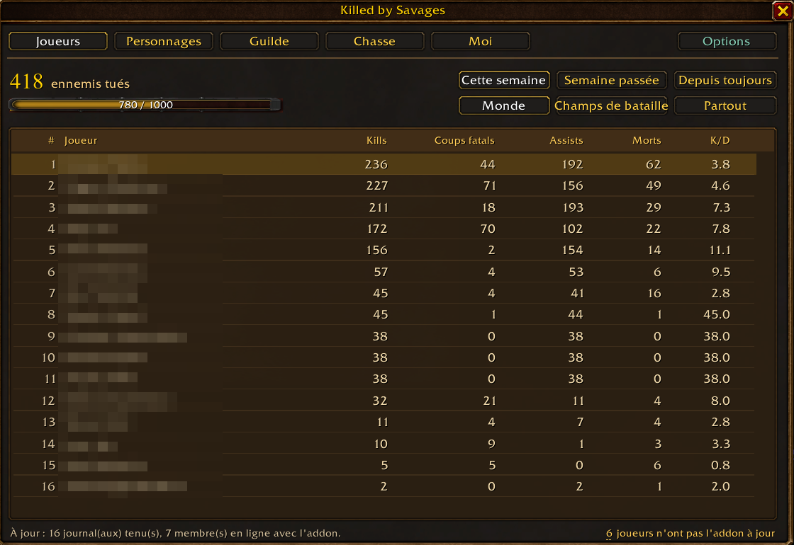
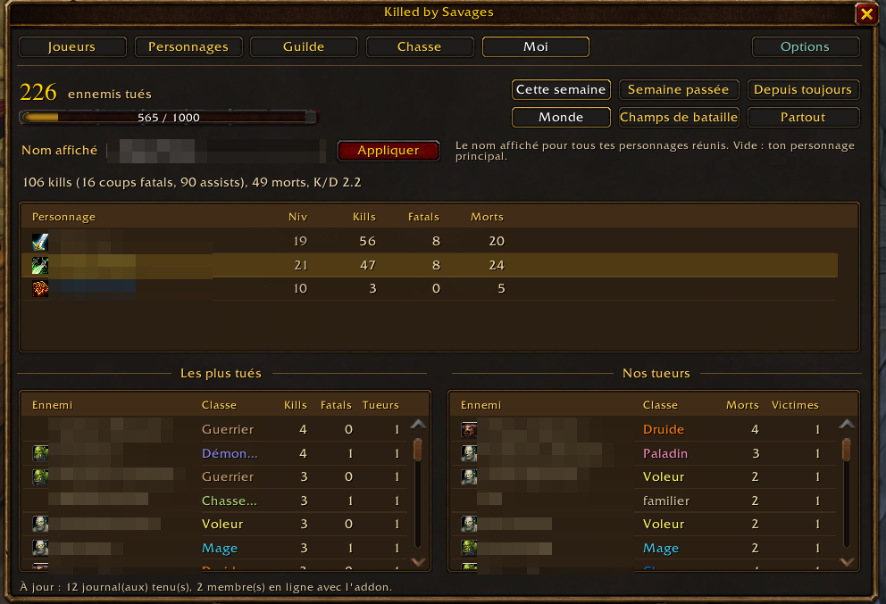
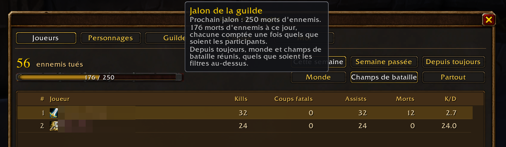
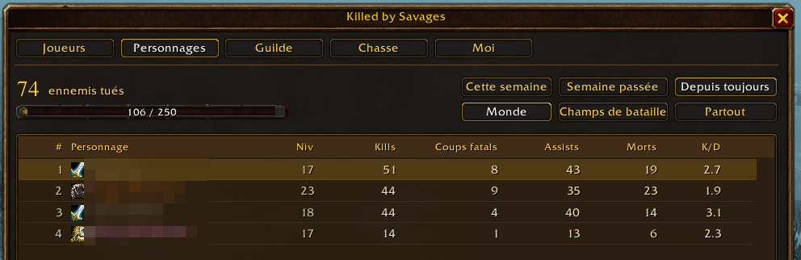

# CurseForge project page

The texts of the CurseForge project, kept here so the page and the repo say
the same thing. Game: World of Warcraft, game version 1.60.1 (Forever,
interface 16001). Category: PvP. License: GNU General Public License
version 3.0. Source: https://github.com/Mouchoir/Killed-by-Savages.

The screenshots (names pixelated) are in `docs/screenshots`; the same four
are in the project's gallery, and the description shows them from there.

## Name

Killed by Savages

## Summary

Guild kill board for WoW: Forever: who killed how many enemies, per player,
per character and for the whole guild, in the world and in battlegrounds.

## Gallery

| File | Title | Description |
| --- | --- | --- |
| `players.png` | Players ranking | The home view: every player of the guild with kills, killing blows, assists, deaths and K/D, the enemies killed and the next guild milestone above. |
| `me-hunting-boards.png` | Your tab and the hunting boards | Your characters and numbers, the enemies you kill the most and the ones who kill you the most. |
| `milestone.png` | Guild milestone | The bar toward the next guild milestone, explained on hover. |
| `characters.png` | Characters ranking | Every character on its own, in the world, in battlegrounds or both. |

## Description

## Your guild's kill board for World of Warcraft: Forever

**Every enemy your guildmates bring down, counted, ranked and shared.**
Killed by Savages turns world PvP into a live guild leaderboard: who hunts
the most, who lands the killing blows, who keeps dying, this week, last
week or since day one. Install it, and every member running it shares
their kills with the rest of the guild, right inside the game.

### What you get

- **Guild leaderboards.** By player (all the characters of one account
  together), by character, and for the whole guild. Open world,
  battlegrounds or both; this week, last week or all time.
- **Kills, killing blows and assists, apart.** An assist counts the way the
  game counts it, and you still see who finished the job.
- **The hunting board.** The enemies your guild kills the most, and the
  ones who kill you the most. Know your prey. Know your nemesis.
- **Guild milestones.** A bar toward the next one, from 100 enemy deaths
  all the way to 100,000, each enemy counted once however many of you took
  part.
- **Battlegrounds done right.** The game hides enemies during a match, so
  the final scoreboard is kept instead, and every guildmate on it is
  credited, with or without the addon.
- **Kill feed.** Optional: every guild kill and death in your chat, your
  guildmate always first: "X (38) killed Y (41) (2-1)", "X (38) was killed
  by Y (41) (2-2)". Enemy levels come in the colour the game gives them on
  the target frame, with its skull for one too high to read. In a tab of
  its own, made for you with one button, or in your main chat.
- **Your own corner.** Your characters, the role each one plays and which
  one is your main, your numbers, your own hunting board, and the name the
  board shows for you.
- **Guild ranks to give.** The guild master picks the rank a main needs
  once it runs the addon, and the rank of alts. The ranks it chooses then
  see, right on the board, who is still waiting for a promotion.
- **Syncs by itself.** Kills land on everyone's board as they happen, and
  members who were offline catch up from whoever is online. The board even
  tells you who still runs an old version, and when yours is one.

### How it counts

Kills are the honorable kills the server grants, so an assist counts like a
killing blow, as in the game. The victim is named from the killing blow of
you, your pet or your group, or from the enemy who died next to you. Deaths
come from the death recap, with the killer and the spell. The guild total
counts each enemy death once, whoever took part. Players are grouped by a
salted hash of their BattleTag: the tag itself is never kept or sent.

### What leaves your client

Only hidden addon messages to your own guild, never chat text, never
anything outside the game: your kill and death records, your battleground
scoreboards, your profile (name, class, race, realm, level, the BattleTag
hash, your display name, the role and the main you chose, the addon
version) and, every ten minutes, your addon version. A guild master's rule
on ranks goes to its guild the same way. There is no server.

### Commands

`/kbs` opens the board (so does the minimap button), `/kbs status` says
where the addon stands, `/kbs options` opens its options, `/kbs discord`
gives the link to the addon's Discord, `/kbs preview` shows example lines of
the kill feed, `/kbs debug` prints the sync state for a bug report.

Built for the guild Savages, made for any guild, on either faction. In
English and French. Source, issues and the test harness:
https://github.com/Mouchoir/Killed-by-Savages

Discord (new versions, bug reports, ideas): https://discord.gg/wqYecPR8yC

---

### En français

**Le tableau de chasse de votre guilde sur WoW Forever.** Chaque ennemi
abattu par un membre est compté, nommé quand le jeu le permet, et partagé
avec toute la guilde, directement en jeu. Classements par joueur (tous ses
personnages réunis), par personnage et pour la guilde, en monde ouvert et
en champ de bataille, sur la semaine, la semaine passée ou depuis toujours.
Coups fatals et assists à part, tableau de chasse avec vos proies favorites
et vos pires ennemis, jalons de guilde, fil des kills en option (dans un
onglet dédié ou dans le chat principal) et un onglet rien que pour vous. En
champ de bataille, le tableau de score final crédite chaque membre de la
guilde présent, avec ou sans l'addon. Le tableau signale aussi qui n'a pas
l'addon à jour, et vous prévient quand c'est le vôtre. Le maître de guilde
peut indiquer le grade attendu d'un personnage principal et celui des
rerolls : les grades qu'il choisit voient alors, sur le tableau, qui attend
encore sa promotion. Aucun serveur, aucun
site : les données circulent entre membres par messages d'addon cachés.
Interface en français et en anglais. Discord (nouvelles versions, rapports
de bug, idées) : https://discord.gg/wqYecPR8yC
